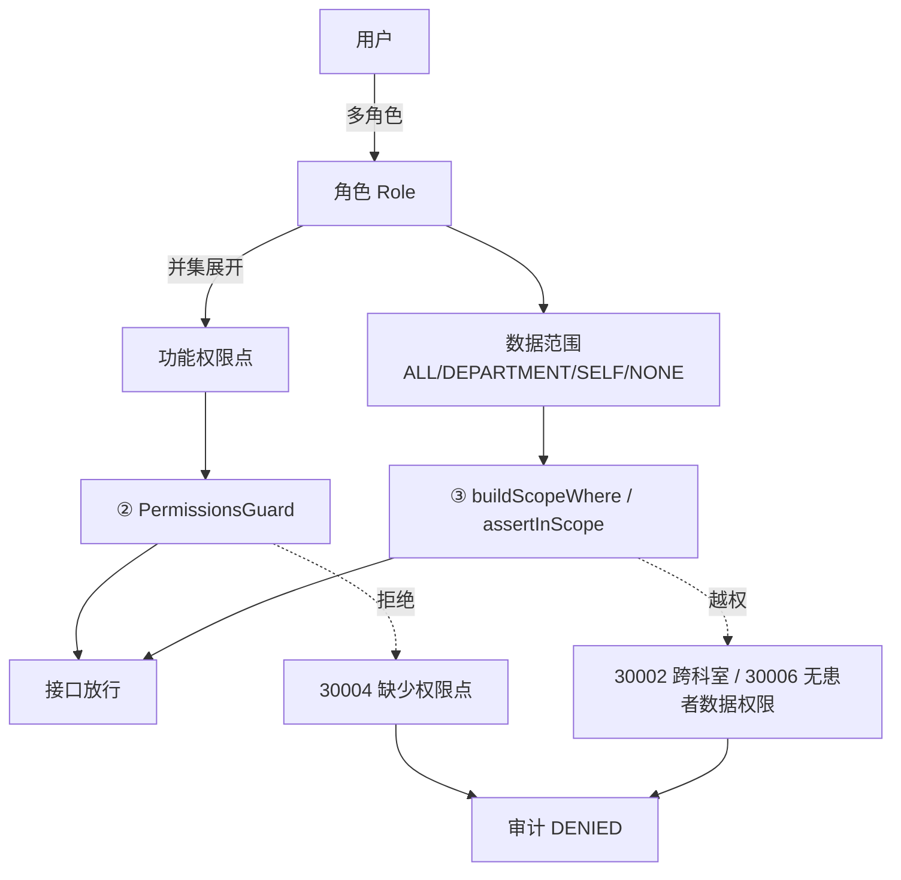

# 权限控制方案（v1 · 已确认落地 P0–P1）

> 设计要点与全部决策见本文档；日常开发约束见 `.codebuddy/rules/permissions.md`。

## 0. 结论

用户提出的思路（登录后下发完整权限 → 前端按权限集合决定模块与交互）**方向正确，但只覆盖了三层中的一层**：

| 层 | 状态 |
|---|---|
| ① 功能权限（能点什么） | 已有 `PERMISSION` + `PermissionsGuard` + 菜单过滤 |
| ② 数据权限（能看哪些数据） | **本次新增**：`DATA_SCOPE` 常量原先定义了但从未使用，越权判断靠手写 `departmentId` 比较 |
| ③ 权限变更生效 | 方案已定（JWT 只带 `sub` + `pv`），实施排在 P2 |

## 1. 模型：RBAC（功能）+ 数据范围（数据）



- 权限点取**并集**（`resolvePermissions`）
- 数据范围取**最宽松档**（`resolveDataScope`），无有效角色 → `NONE`
- 非法角色码一律忽略，避免脏数据扩大权限

## 2. 已实施（P0–P1）

| 改动 | 文件 |
|---|---|
| 资源类型 `RESOURCE` + `PATIENT_SCOPED_RESOURCES` + `resolveDataScope` + `DATA_SCOPE_LABELS` | `packages/shared/src/dict/roles.ts` |
| 脱敏工具 `maskIdCard` / `maskPhone` / `maskName` / `maskPatientNo` | `packages/shared/src/mask/index.ts` |
| 新增错误码 `30006` | `packages/shared/src/error/codes.ts` |
| `AuthenticatedUser` 增加 `roles` / `dataScope` / `permissionVersion` | `apps/server/src/common/types.ts` |
| `@RequireDataScope(resource)` 装饰器 | `apps/server/src/common/data-scope/data-scope.decorator.ts` |
| `buildScopeWhere` / `assertInScope` / `canAccessResource` | `apps/server/src/common/data-scope/scope.util.ts` |
| 数据范围注入由 `scope.util` 统一实现（禁止在 service 手写部门比较） | `apps/server/src/common/data-scope/*` |
| JWT 下发 `roles` / `dataScope`；`profile` 返回 `roles` / `dataScope` / `permissionVersion`；`login` 返回 `expiresAt` | `apps/server/src/modules/auth/*` |
| 单元测试 18 项（四档 × 资源类型 × 越权边界） | `apps/server/src/common/data-scope/scope.util.spec.ts` |
| 前端 `Profile` 类型扩展 + 顶栏展示数据范围标签 | `apps/web/src/store/auth.ts`、`layouts/BasicLayout.tsx` |

### 实测结果

```
dr.wang 登录      roles=DOCTOR dataScope=DEPARTMENT pv=2026-10-21T05:14:53Z expiresAt=...
本科室患者查询     code=0 total=43
dr.chen 跨科室     HTTP403 {"code":30002,"message":"无权访问其他科室的患者数据"}
设备管理员访问患者  HTTP403 {"code":30004"}   ← 功能权限先拦（无 patient:view）
                                             30006 由单元测试覆盖（数据范围层）
```

## 3. 后续计划

| 阶段 | 内容 |
|---|---|
| P2 | JWT 瘦身为 `sub` + `pv`；服务端权限缓存（进程内，多实例改 Redis）；`pv` 失效实现变更即时生效；账号停用强制下线（`jti` 黑名单） |
| P3 | 前端 `<PermissionRoute>` 路由守卫 + `<Auth>` 按钮组件 + `usePermission` |
| P4 | 权限变更生效联调 + 审计按错误码统计安全事件 |
| P5 | 敏感字段脱敏接入患者建档/详情接口 + 按需查看留痕（含权限点与审计） |

## 4. 数据范围四档语义

| 档 | PATIENT | DEVICE | AUDIT |
|---|---|---|---|
| ALL | `{}` | `{}` | `{}` |
| DEPARTMENT | `departmentId` | `departmentId` | `departmentId` |
| SELF | 拒绝（30006） | `departmentId`（台账属科室） | `operatorId` |
| NONE | 拒绝（30006） | `departmentId` | `departmentId` |

未知资源类型一律按最小权限拒绝（`default` 分支）。

> **复用既有资源、不新增类型的范例**：虚拟病区（`modules/ward`，2026-11-18 上线）的患者进出操作
> 一律标 `@RequireDataScope(RESOURCE.PATIENT)`，数据权限完全沿用患者域（跨科室 `30002`、`NONE` 档 `30006`），
> `scope.util.ts` 与 `ROLE_DATA_SCOPE` **一字未改**；功能权限新增 `ward:view` / `ward:manage` 两点（查看与操作分离）。
> 新增"挂在患者下"的子资源时应照此办理——只为真正独立的资源域新建类型，避免语义表随子功能膨胀。
